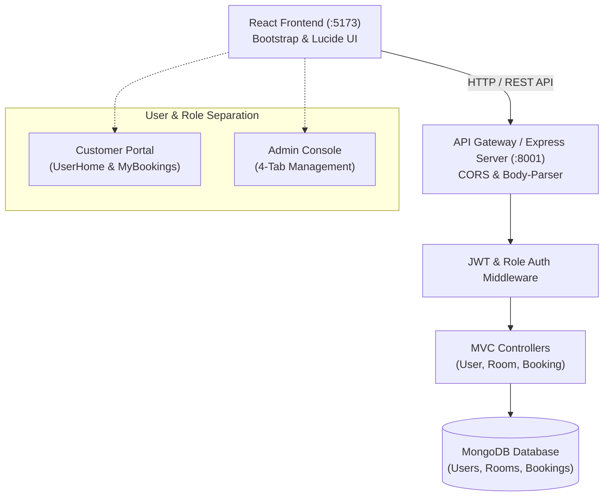
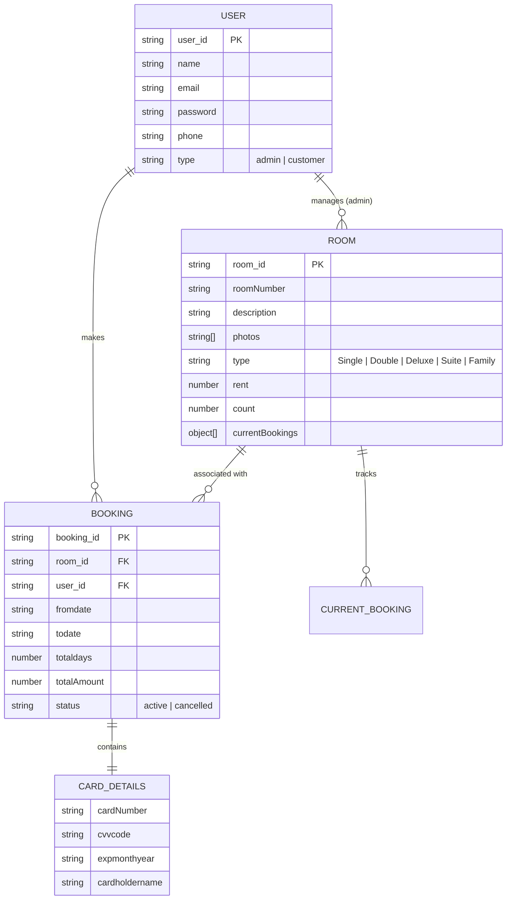
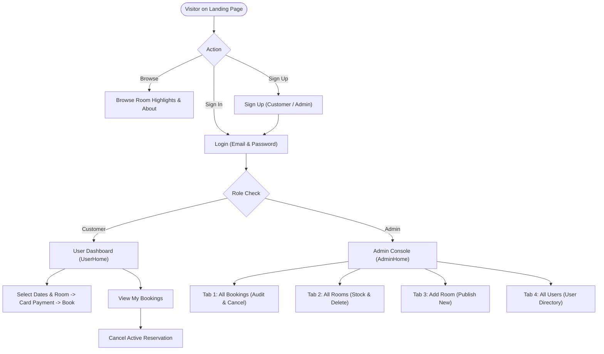

# 🏨 HotelPro - Complete Hotel Booking & Management Solution

[](https://react.dev)
[](https://nodejs.org/)
[](https://expressjs.com/)
[](https://react.dev)
[](https://getbootstrap.com/)
[](https://www.mongodb.com/)
[](https://jwt.io/)

**HotelPro** is a comprehensive, production-grade hotel management and room reservation platform designed to meet the evolving needs of modern hospitality. Engineered with a Model-View-Controller (MVC) architecture, HotelPro simplifies room inventory management, reservation tracking, guest check-ins/outs, and payment processing with bank-grade security and role-based access control.

---

## 📑 Table of Contents

- [Key Highlights](#-key-highlights)
- [System Architecture](#-system-architecture)
  - [Technical Architecture](#technical-architecture)
  - [MVC Pattern](#mvc-pattern)
  - [Entity-Relationship (ER) Diagram](#entity-relationship-er-diagram)
  - [User Flow](#user-flow)
- [Features](#-features)
  - [Visitor Experience](#1-visitor-experience)
  - [Customer Experience](#2-customer-experience)
  - [Administrator Console](#3-administrator-console)
- [Tech Stack](#-tech-stack)
- [Project Directory Structure](#-project-directory-structure)
- [Getting Started](#-getting-started)
  - [Prerequisites](#prerequisites)
  - [Backend Setup (Express API)](#step-1-backend-setup)
  - [Frontend Setup (React Client)](#step-2-frontend-setup)
- [Demo Credentials](#-demo-credentials)
- [API Reference](#-api-reference)

---

## 🌟 Key Highlights

- **Role-Based Portals**: Dedicated, secured interfaces for **Customers** and **Administrators**.
- **Modern Responsive UI**: Built with React 18, Vite, Bootstrap 5, and Lucide icons featuring glassmorphism and modern gradient styling.
- **Robust Security**: Salted password hashing via `bcryptjs` and session authentication with stateless JSON Web Tokens (`JWT`).
- **Simulated Payment Gateway**: Card details processing (`cardNumber`, `cvvcode`, `expmonthyear`, `cardholdername`) with PCI-compliant masking and instant reservation confirmation.
- **Zero-Setup Database Fallback**: Auto-connects to MongoDB or dynamically spins up an embedded in-memory MongoDB runner pre-seeded with 5 luxury suites and demo accounts.

---

## 🏛️ System Architecture

### Technical Architecture



### MVC Pattern

The backend follows the clean **Model-View-Controller (MVC)** architectural pattern:

- **Model Layer (`server/models/`)**: Mongoose schemas defining database structures for `User`, `Room`, and `Booking`.
- **View / Routing Layer (`server/routes/`)**: REST API route endpoints handling client HTTP requests (`/api/users`, `/api/rooms`, `/api/bookings`).
- **Controller Layer (`server/controllers/`)**: Business logic, input validation, date/cost calculations, and database interactions.

### Entity-Relationship (ER) Diagram



### User Flow



---

## 🚀 Features

### 1. Visitor Experience
- **Hero Carousel**: Responsive image slider highlighting luxury rooms and presidential suites.
- **Quick Booking Bar**: Instant search filters by category and flexible stay policies.
- **Curated Room Previews**: Displays room categories, nightly rates, amenities, and availability badges.
- **About HotelPro**: Detailed section showcasing reliability, privacy, encryption, and operational efficiency.

### 2. Customer Experience
- **Personalized Greeting**: Welcomes logged-in users with `Hi, {user.name}!`.
- **Category & Keyword Filtering**: Real-time room filtering by room type (`Deluxe`, `Suite`, `Double`, `Single`, `Family Suite`) and search terms.
- **Interactive Reservation Modal**:
  - Check-in and check-out date picker with automated duration calculation.
  - Nightly rate and total amount due computation.
  - Credit card checkout simulation (`cardNumber`, `cvvcode`, `expmonthyear`, `cardholdername`).
- **My Bookings Dashboard**:
  - Chronological reservation cards showing Booking ID, room number, type, dates, stay duration, and amount.
  - **Cancel Booking**: Real-time cancellation that frees the room's current booking slot.

### 3. Administrator Console
- **Personalized Header**: `Hi, {admin.name} (Administrator)`.
- **4 Tabbed Modules**:
  1. **All Bookings**: System-wide reservations table with guest names, contact phones, amounts, and admin cancellation override.
  2. **All Rooms**: Comprehensive inventory directory with photo previews, stock counts, and instant room deletion.
  3. **Add Room**: Intuitive form to register new room numbers, types, rates, stock counts, photos, and descriptions.
  4. **All Users**: Registered customer and administrator accounts with IDs, emails, and roles.

---

## 💻 Tech Stack

| Layer | Technologies |
| :--- | :--- |
| **Frontend** | React 18, Vite 5, React Router DOM 6, Bootstrap 5, React-Bootstrap, Lucide React, Axios |
| **Backend** | Node.js, Express.js 4, Mongoose 8, JSON Web Token (JWT), bcryptjs, body-parser, cors, uuid, dayjs |
| **Database** | MongoDB / MongoDB Memory Server fallback for zero-dependency execution |
| **Styling** | Modern Bootstrap 5, Custom CSS Variables, Glassmorphism & Responsive Grids |

---

## 📁 Project Directory Structure

```
skillwallet project/
├── .gitignore                    # Root Git ignore rules
├── README.md                     # Project documentation
├── client/                       # React Frontend (Vite)
│   ├── .gitignore
│   ├── index.html                # HTML entry point with Plus Jakarta Sans
│   ├── package.json              # Client dependencies
│   ├── vite.config.js            # Vite configuration & proxy settings
│   └── src/
│       ├── main.jsx              # React DOM mounting
│       ├── App.jsx               # Application routing & context wrapping
│       ├── index.css             # Custom styles & design tokens
│       ├── context/
│       │   └── AuthContext.jsx   # Global authentication state
│       ├── services/
│       │   └── api.js            # Axios client with JWT interceptors
│       ├── components/
│       │   ├── Navbar.jsx        # Role-aware responsive navigation
│       │   ├── Footer.jsx        # HotelPro brand footer
│       │   ├── HeroCarousel.jsx  # Animated image slider
│       │   ├── RoomCard.jsx      # Room preview card
│       │   ├── BookingModal.jsx  # Reservation & payment modal
│       │   └── ProtectedRoute.jsx# Auth and Admin route guards
│       └── pages/
│           ├── Home.jsx          # Public landing page
│           ├── Login.jsx         # Sign in with 1-click demo buttons
│           ├── SignUp.jsx        # Registration with role selection
│           ├── UserHome.jsx      # Customer room browsing portal
│           ├── MyBookings.jsx    # Reservation history & cancellation
│           └── AdminHome.jsx     # 4-Tab Administrator console
└── server/                       # Node.js Express Backend
    ├── .env                      # Environment variables
    ├── .env.example              # Environment template
    ├── .gitignore
    ├── package.json              # Server dependencies
    ├── server.js                 # Express server & API routes
    ├── index.js                  # Entry point delegating to server.js
    ├── config/
    │   └── db.js                 # MongoDB connection & auto-seeding
    ├── middleware/
    │   └── authMiddleware.js     # JWT verification & admin guard
    ├── models/
    │   ├── User.js               # User Mongoose model
    │   ├── Room.js               # Room Mongoose model
    │   └── Booking.js            # Booking Mongoose model
    ├── controllers/
    │   ├── userController.js     # User registration, login, and list
    │   ├── roomController.js     # Room queries, add, and delete
    │   └── bookingController.js  # Reservations, cancellations, and audit
    └── routes/
        ├── userRoutes.js         # /api/users
        ├── roomRoutes.js         # /api/rooms
        └── bookingRoutes.js      # /api/bookings
```

---

## ⚡ Getting Started

### Prerequisites

- [Node.js](https://nodejs.org/) (v18.0 or newer recommended)
- [npm](https://www.npmjs.com/) (v9.0 or newer)
- *(Optional)* A running MongoDB instance on `mongodb://localhost:27017/hotel`. If not present, HotelPro automatically initiates an embedded MongoDB engine.

---

### Step 1: Backend Setup

1. Open a terminal and navigate to the `server/` directory:
   ```bash
   cd server
   ```

2. Install dependencies:
   ```bash
   npm install
   ```

3. Configure environment variables (a pre-configured `.env` is already included):
   ```env
   PORT=8001
   MONGO_URI=mongodb://localhost:27017/hotel
   JWT_SECRET=hotelpro_super_secret_jwt_key_2026_xyz
   ```

4. Start the backend server:
   ```bash
   npm start
   # Or with automatic reload during development:
   npm run dev
   ```
   The backend API will start on **`http://localhost:8001`**.

---

### Step 2: Frontend Setup

1. Open a new terminal tab and navigate to the `client/` directory:
   ```bash
   cd client
   ```

2. Install dependencies:
   ```bash
   npm install
   ```

3. Launch the Vite development server:
   ```bash
   npm run dev
   ```
   The frontend application will be accessible at **`http://localhost:5173`**.

---

## 🔑 Demo Credentials

To test the system immediately without manual registration, the database is pre-seeded with the following accounts:

| Role | Email | Password | Access Capabilities |
| :--- | :--- | :--- | :--- |
| **Administrator** | `admin@hotelpro.com` | `admin123` | Full access to the 4-Tab Admin Dashboard (All Bookings, Rooms, Add Room, Users) |
| **Customer** | `john@example.com` | `password123` | Room reservation, active stays, and cancellation |

> **Tip**: On the **[Login Page](http://localhost:5173/login)**, you can click the **Customer** or **Admin** quick-fill button to populate demo credentials in one click!

---

## 📡 API Reference

### User Authentication (`/api/users`)

| Method | Endpoint | Description | Access |
| :--- | :--- | :--- | :--- |
| `POST` | `/api/users/signup` | Register a new user (Customer or Admin) | Public |
| `POST` | `/api/users/login` | Authenticate user and receive JWT token | Public |
| `GET` | `/api/users/profile` | Retrieve profile of authenticated user | Authenticated |
| `GET` | `/api/users/all` | Retrieve all registered users | Admin Only |

### Room Management (`/api/rooms`)

| Method | Endpoint | Description | Access |
| :--- | :--- | :--- | :--- |
| `GET` | `/api/rooms` | Retrieve all available hotel rooms | Public |
| `GET` | `/api/rooms/:id` | Retrieve single room by ID | Public |
| `POST` | `/api/rooms/add` | Add a new room configuration | Admin Only |
| `DELETE` | `/api/rooms/:id` | Remove a room by ID | Admin Only |

### Booking Management (`/api/bookings`)

| Method | Endpoint | Description | Access |
| :--- | :--- | :--- | :--- |
| `POST` | `/api/bookings/book` | Reserve room with simulated card payment | Authenticated |
| `GET` | `/api/bookings/mybookings` | Retrieve authenticated user's reservations | Authenticated |
| `POST` | `/api/bookings/cancelbooking` | Cancel an active reservation | Owner / Admin |
| `GET` | `/api/bookings/all` | Retrieve all bookings across all users | Admin Only |

---

## 🔒 Security Best Practices

- **Password Hashing**: Passwords are never stored in plain text; they are hashed using `bcryptjs` with salt rounds.
- **JWT Protection**: Protected routes require a valid `Bearer <token>` in the HTTP `Authorization` header.
- **Card Security**: Credit card numbers are masked (`**** **** **** 1234`) and CVV codes are sanitized before persistence.
- **Role Verification**: Administrative endpoints strictly enforce `admin` privilege verification.

---

## 📄 License

This project is licensed under the [ISC License](LICENSE). Built for educational and enterprise hotel management workflows.
